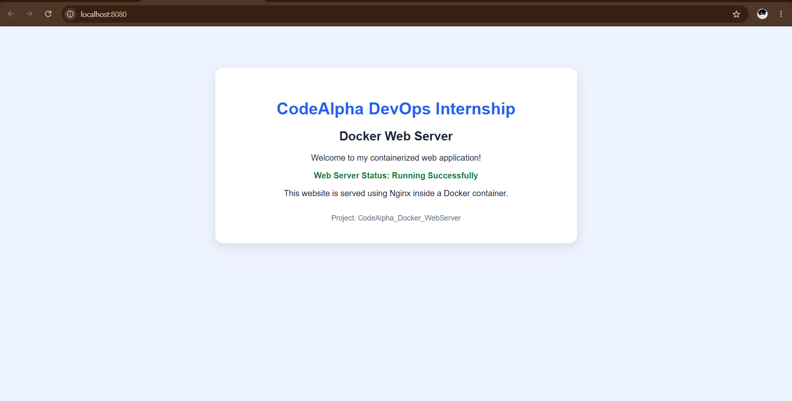
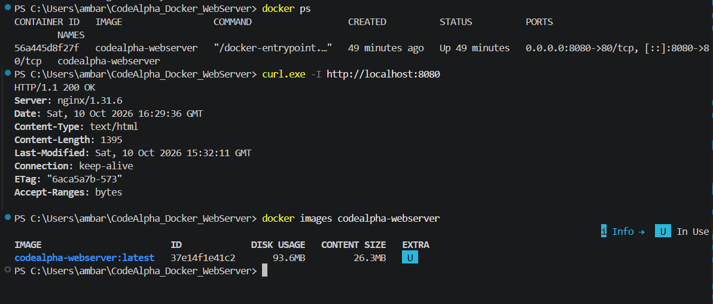

# CodeAlpha Docker Web Server

A containerized web server built with Nginx and Docker as part of the CodeAlpha DevOps Internship.

## Project Overview

This project demonstrates how to build a Docker image and deploy a custom HTML and CSS webpage inside an Nginx container.

## Technologies Used

- Docker Desktop
- Dockerfile
- Nginx (Alpine image)
- HTML and CSS
- Git and GitHub
- Windows 11

## Project Structure

```text
CodeAlpha_Docker_WebServer/
├── Dockerfile
├── index.html
├── README.md
└── screenshots/
    ├── website.png
    └── docker-container.png
```

## Prerequisites

- Windows 11
- Docker Desktop installed and running
- Git installed
- A web browser

## Screenshots

### Running Website



### Running Docker Container



## How to Run the Project

### 1. Clone the Repository

```bash
git clone https://github.com/ambarish158/CodeAlpha_Docker_WebServer.git
cd CodeAlpha_Docker_WebServer
```

### 2. Build the Docker Image

```bash
docker build -t codealpha-webserver .
```

### 3. Run the Container

```bash
docker run -d -p 8080:80 --name codealpha-webserver codealpha-webserver
```

### 4. Open the Website

Visit:

http://localhost:8080

### 5. Verify the Container

```bash
docker ps
```

### 6. Test the HTTP Response

```bash
curl.exe -I http://localhost:8080
```

A successful response should include `HTTP/1.1 200 OK`.

## Troubleshooting

### Container Name Already in Use

If the container already exists, start it with:

```bash
docker start codealpha-webserver
```

### Port 8080 Already in Use

Choose a different host port, such as 8081:

```bash
docker run -d -p 8081:80 --name codealpha-webserver-2 codealpha-webserver
```

Then open http://localhost:8081.

### Docker Engine Not Running

Open Docker Desktop and wait for the engine to start before running Docker commands.

## Learning Outcomes

- Building custom Docker images
- Containerizing a web server
- Configuring host-to-container port mapping
- Running and inspecting containers
- Testing HTTP responses
- Managing project source code with Git and GitHub

## Author

Ambarish

## GitHub Repository

https://github.com/ambarish158/CodeAlpha_Docker_WebServer
